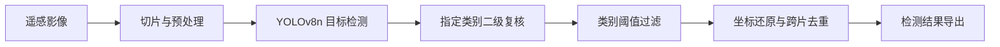

# RSDET · 遥感影像目标检测与识别

面向类别不均衡、小样本及复杂背景场景的遥感目标检测研究项目，覆盖舰船、飞机、车辆三大类下的 25 个细分类别。

项目全称：**基于不均衡小样本学习的光学遥感卫星陆上目标检测识别**。

## 项目目标

从光学遥感影像中识别目标类别与位置，减少易混淆目标和背景产生的误检，并通过切片推理处理高分辨率影像。

## 方法与工程实现

- **基础检测：**采用 YOLOv8n 生成目标候选框与类别预测。
- **定向二级复核：**对指定易混淆类别的候选目标进行复核。
- **类别决策：**根据实验结果设置类别阈值，分析召回与虚警之间的取舍。
- **大图推理：**实现面向 10000 × 10000 像素影像的切片、全图坐标还原、跨片去重和标准化结果导出。
- **实验分析：**开展模块对比、阈值敏感性分析和消融实验。

## 已有评测记录

以下数值依据项目历史实验汇总整理，采用合并全部目标计数的统计方式，不是三大类指标的算术平均。

| 指标 | 历史本地验证结果 |
| --- | ---: |
| TP | 2986 |
| FP | 195 |
| FN | 128 |
| Recall | 95.89% |
| FDR | 6.13% |

计算方式：

- `Recall = TP / (TP + FN)`
- `FDR = FP / (TP + FP)`

该结果对应 C1 配置的历史本地 R4 验证记录。原始预测、评价配置和评测日志尚未纳入本仓库，当前仓库不提供独立复现验证。总体指标受类别分布影响，应结合三大类及细分类结果理解。

## 技术栈

Python · PyTorch · Ultralytics YOLOv8n · OpenCV · NumPy · CUDA

## 当前仓库内容

当前版本为项目介绍页，包含方法概览、历史本地评测结果及上传忽略规则。

训练与推理源代码、模型权重、运行环境文件、原始评测记录、检测结果截图和演示视频尚未纳入仓库，因此当前版本不能直接运行。运行说明将在核对真实代码入口和环境后补充。
